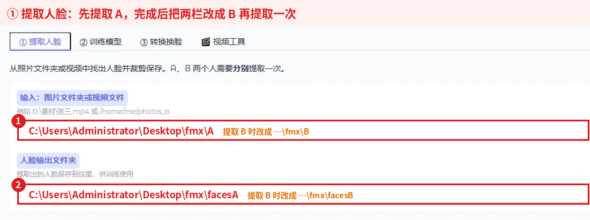
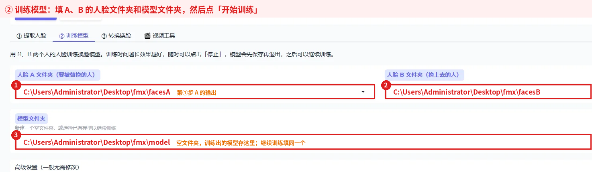
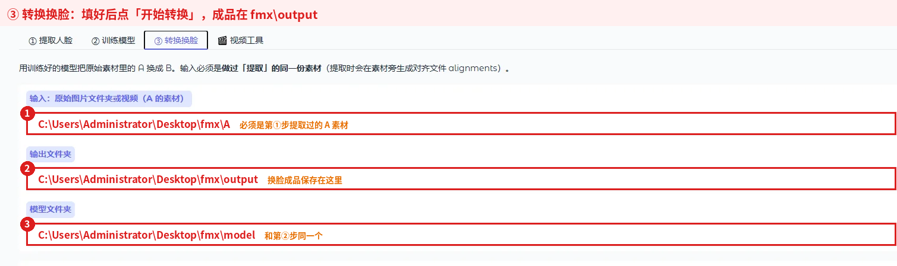
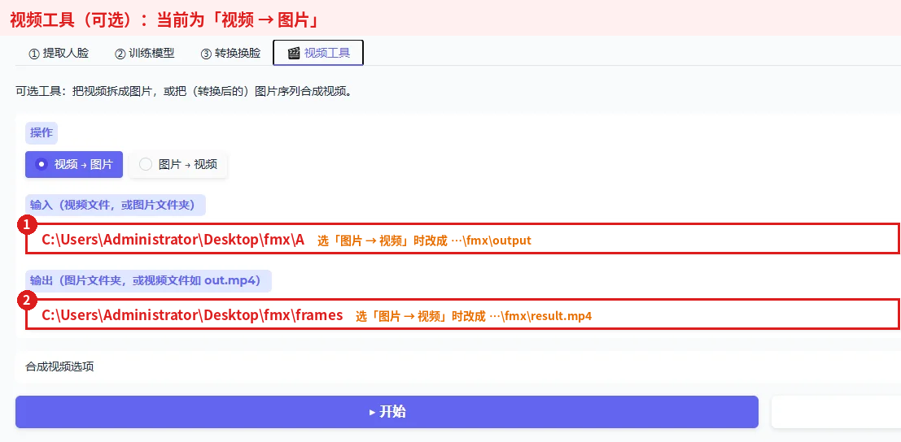

# Faceswap 中文简易版（faceswap-refactored）

基于 [deepfakes/faceswap](https://github.com/deepfakes/faceswap) 的中文简易版：浏览器里的中文向导界面，按 **① 提取 → ② 训练 → ③ 转换** 三步完成换脸；Windows + NVIDIA 显卡提供一键安装包，不用装 Python、不用敲命令。换脸算法与原版完全相同。

> **使用须知：** 请仅在获得所有相关人员明确同意的情况下使用其照片或视频，并遵守当地法律法规。禁止用于欺诈、骚扰、色情或侵犯他人权益的用途。

## 下载

到本仓库右侧 **Releases** 下载最新版本，两种方式任选其一：

| 方式 | 下载哪些文件 | 怎么用 |
|---|---|---|
| **安装版（推荐）** | `FaceswapSimple-Setup.exe`、`FaceswapSimple-Setup-1.bin`、`FaceswapSimple-Setup-2.bin` | 三个放在同一文件夹，双击 Setup.exe 安装 |
| 便携版 | `FaceswapSimple-win64-nvidia.7z.001`、`.7z.002` | 用 7-Zip 解压 `.001`，运行里面的 `FaceswapSimple.exe` |

`Source code` 是源代码，普通用户不用下载。

**电脑要求：** 64 位 Windows 10/11，NVIDIA **RTX 20 系列或更新**显卡，显卡驱动 **580 或更新**，建议 16 GB 内存，至少 15 GB 硬盘空间。GTX 10 系列及更老显卡、AMD/Intel 显卡不支持安装包，请使用原版。

## 一步步操作（Windows 小白版）

### 第 0 步：检查显卡和驱动

1. 按 **Ctrl + Shift + Esc** 打开任务管理器 →「性能」→「GPU」，右上角应显示 **NVIDIA GeForce RTX ……**。
2. 按 **Win 键**，输入 `cmd` 回车，输入 `nvidia-smi` 回车，**Driver Version** 要 ≥ 580；不够就到 NVIDIA 官网更新驱动并重启。

### 第 1 步：安装

1. 双击 **FaceswapSimple-Setup.exe**；出现「Windows 已保护你的电脑」时点「**更多信息**」→「**仍要运行**」。
2. 一路「下一步」，许可协议选「我同意」。
3. 安装位置默认 `C:\FaceswapSimple`，C 盘空间不够就改成 `D:\FaceswapSimple`。不要装进 `Program Files`，路径不要有中文和空格。
4. 勾选「**创建桌面快捷方式**」→「安装」→「完成」。

### 第 2 步：打开程序

1. 双击桌面「**Faceswap 简易版**」。先出现的**黑色窗口是程序本体，用的时候不要关**。
2. 稍等片刻浏览器会自动打开；没打开就在地址栏输入 `127.0.0.1:7860` 回车。
3. 页面顶部勾选「**我已阅读并同意使用须知**」，预设模式选「**新手模式**」。

### 第 3 步：设置工作文件夹（只做一次）

1. 页面顶部「**📁 工作文件夹**」填一个英文路径，例如 `D:\fs`（放桌面也行，如 `C:\Users\Administrator\Desktop\fmx`）。
2. 点「**✔ 应用（自动填好路径）**」：自动建好下面的文件夹，并填好所有步骤的路径，下次打开自动沿用。

```
D:\fs\A        ← 放 A 的素材：要被换掉脸的人（1 个视频，或若干 jpg/png 照片）
D:\fs\B        ← 放 B 的素材：要换上去的脸
D:\fs\facesA   提取出的 A 人脸
D:\fs\facesB   提取出的 B 人脸
D:\fs\model    训练出的换脸模型
D:\fs\output   换脸成品
D:\fs\frames   视频工具拆出的图片
```

3. 把 A 的视频（或照片）放进 `A`，B 的放进 `B`。每个文件夹**只放一个视频**或只放照片，不要套子文件夹；webp/heic/jfif 照片先转成 jpg。

4. 工作文件夹下方的**进度表**会显示素材、人脸、模型、成品的情况，并提示「下一步」该做什么；做完一步可点「🔄 刷新进度」。每一步的「📂 打开输出文件夹」可以直接打开结果所在的文件夹。

> 也可以不用工作文件夹，在每一栏手动粘贴完整路径（右键文件 →「复制为路径」，带引号也行）。下面的截图以 `C:\Users\Administrator\Desktop\fmx` 为例。

### 第 4 步：提取人脸（A、B 各一次）



1. 「① 提取人脸」页点「**👤 填入 A 的路径**」→「**▶ 开始提取**」，等状态变成 ✅ **已完成**。
2. 点「**👤 填入 B 的路径**」→「▶ 开始提取」，再等 ✅ 已完成。
3. **挑图**：打开 `facesA`、`facesB`（右键 → 查看 → 大图标），删掉别人的脸、模糊的、被挡住的。每边至少 25 张，几百张以上更好。
4. `A`、`B` 里生成的 `*_alignments.fsa` **不要删**，转换时要用。

### 第 5 步：训练模型（最耗时）



1. 「② 训练模型」页路径已填好，点「**▶ 开始训练**」。
2. 右侧预览会从模糊慢慢变清楚，新手模式一般要几个小时。满意后点「**⏹ 停止**」；下次再点开始会接着练。
3. 黑窗口出现 `out of memory`（显存不足）：「高级设置」里把「批大小」从 8 改成 4。

> 内置的只是找人脸用的通用模型；换脸模型要用你的 A、B 现场训练，保存在 `model` 文件夹。

### 第 6 步：生成换脸视频



「③ 转换换脸」页路径已填好，点「**▶ 开始转换**」，✅ 已完成后打开 `output` 文件夹就是成品。

### 视频工具（可选）



「视频 → 图片」把 `A` 的视频拆到 `frames`；「图片 → 视频」把 `output` 里的图片合成 `result.mp4`。转换视频时成品本来就是视频，一般用不到。

### 用完怎么关

先关浏览器页面，再关黑色窗口。只关浏览器的话程序还在后台运行。

## 常见问题

| 现象 | 解决办法 |
|---|---|
| 「没有找到可处理的图片或视频帧」/ 日志 `Images found: 0` | 输入文件夹里没有 jpg/png。文件夹里只放一个视频会自动识别；有多个视频时直接填视频文件路径。 |
| 图片文件夹只处理了一部分照片 | v1.1.0 的新手模式会每 5 张取 1 张，请升级到最新版，或在「高级设置」把「每 N 帧」改成 1。 |
| 提取一直 0%，日志有 `Downloading model` / `timed out` | 版本太旧，请安装最新版（已内置模型）。 |
| 「路径不存在」 | 检查盘符、文件名、扩展名。 |
| 「没检测到人脸」 | 换脸更大、更清楚、正脸更多的素材。 |
| 「已有任务正在运行」 | 一次只能做一件事，等完成或先点停止。 |
| 显卡 / NVML / CUDA 报错 | 更新显卡驱动到 580+ 并重启；确认是 RTX 20 系列或更新。 |
| 浏览器打不开 / 端口被占用 | 手动打开 `127.0.0.1:7860`；或在 cmd 运行 `"C:\FaceswapSimple\FaceswapSimple.exe" --port 8000`。 |
| 怎么卸载 | Windows 设置 → 应用 → Faceswap 简易版 → 卸载。素材和模型不会被删除。 |

还有问题请到 Issues 提问，附上「运行日志」截图。

## 与原版的区别

- **新增中文简易界面**：三步向导、新手预设、工作文件夹自动填路径、中文报错提示、进度条和训练预览。原版英文 GUI 和命令行照常可用。
- **新增 Windows 安装包**：内置 Python、PyTorch（CUDA 13）和常用模型，装完即用。
- **修复若干 bug**、清理代码并补充测试，算法和模型文件与原版互通。详情见 [docs/REFACTOR_zh-CN.md](docs/REFACTOR_zh-CN.md)。

## 开发者

- 从源码运行简易界面：按 [USAGE_zh-CN.md](USAGE_zh-CN.md) 装好 Faceswap 后，`pip install -r requirements/_requirements_simple_gui.txt`，再运行 `python app.py`。参数说明见 [SIMPLE_GUI_zh-CN.md](SIMPLE_GUI_zh-CN.md)。
- 运行测试：

```bash
pip install torch torchvision --index-url https://download.pytorch.org/whl/cpu
pip install -r requirements/_requirements_base.txt pytest
export KERAS_BACKEND=torch
pytest tests
```

- 发布新版：推送 `v*` 标签，`build/windows-nvidia` 工作流会自动构建并上传安装包。

## 许可证

与上游项目相同，采用 [GPL-3.0](LICENSE) 许可证。
